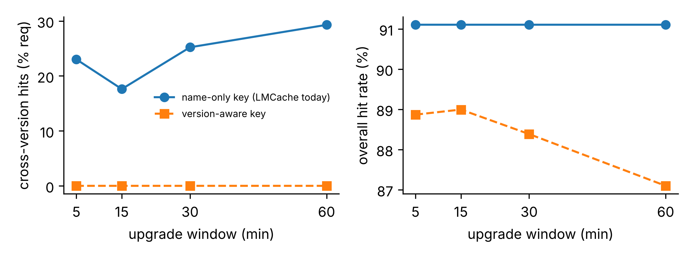
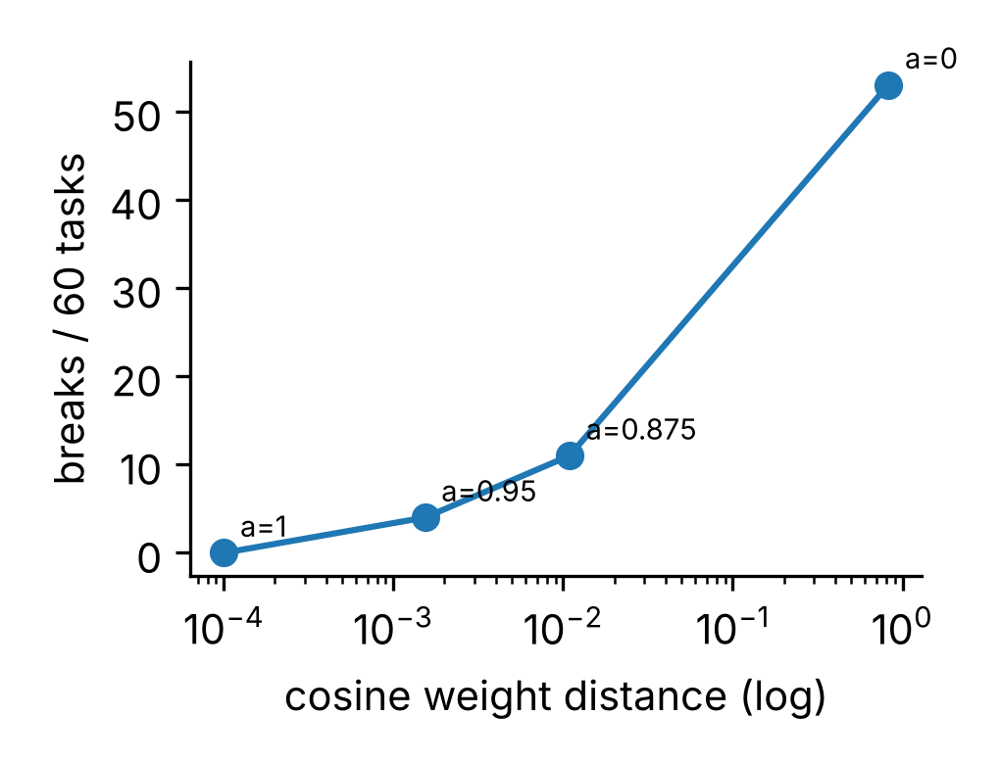

# kvskew: stale KV-cache reuse across model versions

Code and data for the paper **"Stale Computation: Version-Skewed KV-Cache Reuse
in Disaggregated LLM Serving"** (Amit Rajula, IEEE PDGC 2026, to appear).

LLM serving systems increasingly share the KV cache across instances, in host
memory, local disk or a remote store, so one server can reuse attention state
another server computed. That is only correct if both servers run the same
weights. This repository shows that a widely used shared-cache key cannot tell
two checkpoints of the same model apart, measures how often that happens during
a rolling upgrade, and measures what it does to answers.

## The gap, in one command

```bash
cd src
python lmcache_key_repro.py --show-tag-workaround
```

```
model name 'acme/chat-8b', same prefix, same TP layout, same dtype, different weights

  revision 3f1c9e0   acme/chat-8b@1@0@407fd6983dcd3874@bfloat16
  revision 8a72d41   acme/chat-8b@1@0@407fd6983dcd3874@bfloat16
  -> SAME KEY: revision B will load KV computed by revision A

with lmcache.tag.revision sent on every request (in-process connector):
  revision 3f1c9e0   acme/chat-8b@1@0@407fd6983dcd3874@bfloat16@revision%3f1c9e0
  revision 8a72d41   acme/chat-8b@1@0@407fd6983dcd3874@bfloat16@revision%8a72d41
  -> different keys: the revisions are kept apart
```

LMCache's `CacheEngineKey` (`lmcache/utils.py`, checked at commit `a2cd25df`,
2026-10-25) is

    model_name @ world_size @ worker_id @ chunk_hash @ dtype [@ tag%value ...]

It separates tensor-parallel layout and, since November 2025 (PR #1859),
numeric precision. It has no field for the model revision. The chunk hash is
computed over token ids, which do not depend on the weights, so two instances
serving the same model name at different revisions produce the same key for the
same prefix.

There is an opt-in workaround: the in-process connector folds request configs
named `lmcache.tag.*` into the key, so sending `lmcache.tag.revision` on every
request separates the revisions. It only works if every client sets it, and
LMCache's multiprocess-mode documentation says tags are metadata there, not
cache identity. A revision field in the key itself is the fix this work argues
for.

`python lmcache_key_repro.py --use-lmcache` runs the same comparison on real
`CacheEngineKey` objects from an installed LMCache instead of this repository's
copy of the format.

### Scope

The hazard is specific to the **cross-instance, persistent** cache tier. vLLM's
in-process prefix cache is not affected: it is scoped to the loaded model and
its entries do not outlive the process. Please keep that distinction when
citing this work.

SGLang's HiCache storage tier was checked as well (commit `b50d439`,
2026-11-02): neither its default rank-suffix keys nor its `unified`
`KVCacheNamespace` carry a weight version. SGLang separately tracks which weight
version produced each KV slot on the GPU (`--enable-prefill-weight-versions`),
which shows the project already treats "which weights produced this KV" as
worth recording.

## Results

Numbers match the paper. Every one is backed by a file in `results/` except
two rows of the severity table, noted in `results/README.md`.

### How often: rollout exposure (simulation)

`src/frequency.py`, 16 instances upgraded in batches of 4, 2 requests/s,
Zipf-popular prefixes, 30-minute entry lifetime, 3 seeds. The checked-in
`results/frequency.csv` is reproduced byte-for-byte by a fresh run.

| Upgrade window | Cross-version hits, name-only key | Hit rate, name-only | Hit rate, version-aware |
|---|---|---|---|
| 5 min  | 23.0% | 91.1% | 88.9% |
| 15 min | 17.6% | 91.1% | 89.0% |
| 30 min | 25.2% | 91.1% | 88.4% |
| 60 min | 29.3% | 91.1% | 87.1% |

Between 17 and 31 percent of requests (per-seed range) read KV written by the
other version. A version-aware key removes them at a cost of 2 to 4 points of
hit rate. Exposure is highest at the longest window, but it is not monotonic:
the 5-minute window exceeds the 15-minute one.



### How much: severity (real models, CPU)

`src/kv_quality.py`. Model A prefills the prompt; model B generates the answer
from A's KV. Control is B on its own KV. 120 ground-truth tasks in three
strata (recall, arithmetic, answer-in-context), greedy decoding, exact McNemar
test on discordant pairs.

| Skew | Control | Stale | Breaks / fixes | p |
|---|---|---|---|---|
| fp32 KV → bf16 server (Qwen2.5-0.5B-Instruct) | 0.925 | 0.942 | 0 / 2 | 1 |
| Qwen2.5-0.5B base → Instruct | 0.942 | 0.925 | 4 / 2 | 0.34 |
| Qwen2-0.5B → Qwen2.5-0.5B-Instruct | 0.942 | 0.033 | 109 / 0 | 1.5e-33 |

Within a model family the reuse is behaviourally harmless in these
measurements. Across a model generation, with identical vocabulary size, layer
count, KV heads and head dimension verified, accuracy collapses and the output
stops being language. The producing model on its own scores 0.750 on the same
tasks, so the collapse is incompatibility, not a weaker writer.

### Damage against weight distance (interpolation sweep)

`src/interp_sweep.py` builds synthetic checkpoints `(1-a)·Qwen2 + a·Qwen2.5-Instruct`
and uses each as the KV writer. Points whose interpolated model scores ~0 on
its own are excluded (a=0.25, 0.5, 0.75): they say nothing about compatibility.

| a | Cosine distance | Writer alone | Stale | Breaks / 60 |
|---|---|---|---|---|
| 1.000 | −0.0001 | 0.950 | 0.950 | 0 |
| 0.950 | 0.0015 | 0.883 | 0.883 | 4 |
| 0.875 | 0.0109 | 0.483 | 0.767 | 11 |
| 0.000 | 0.828 | 0.750 | 0.067 | 53 |

The usable points are consistent with damage growing with distance rather
than a single step, but nothing between 0.011 and 0.828 is measured, so the
shape of the transition is not established.



## Reproduce

```bash
python -m venv .venv && source .venv/bin/activate
pip install -r requirements.txt
cd src

# seconds, no model
python lmcache_key_repro.py --show-tag-workaround
python frequency.py
python make_figures.py

# CPU, downloads 0.5B models (minutes to tens of minutes each)
python kv_quality.py --mode dtype      --model Qwen/Qwen2.5-0.5B-Instruct
python kv_quality.py --mode checkpoint --model-a Qwen/Qwen2.5-0.5B --model-b Qwen/Qwen2.5-0.5B-Instruct
python kv_quality.py --mode checkpoint --model-a Qwen/Qwen2-0.5B   --model-b Qwen/Qwen2.5-0.5B-Instruct
python interp_sweep.py --limit 60

# replication attempts reported in the paper (Section V-E)
python distance_sweep.py --model EleutherAI/pythia-160m
python family_matrix.py

# token-level divergence probe (5 prompts; an early instrument)
python kv_severity.py --mode checkpoint --model-a Qwen/Qwen2.5-0.5B --model-b Qwen/Qwen2.5-0.5B-Instruct
```

Each run writes to `results/` with the configuration in the file name.
`reproduce.sh` runs the whole list. See `results/README.md` for which file
backs which table.

## How the measurement got here

Hypotheses and decision rules were written into each script before it was run,
and the record of what failed is kept on purpose:

1. **Divergence is not error.** The first probe (`kv_severity.py`) measured
   token agreement with the control. Stale outputs often differed while being
   correct, so agreement could not support a quality claim.
2. **Too few tasks.** The first quality probe (`superseded/kv_quality_v1.py`)
   used 15 easy tasks; control was at ceiling and two breaks cannot support a
   rate.
3. **Scoring bugs.** The 120-task version (`superseded/kv_quality_v2.py`)
   reported 10 breaks / 4 fixes, p = 0.09. Inspection found two harness bugs:
   accented answers ("Brasília") scored wrong, and a 14-token budget cut off
   correct but longer answers. After fixing both (`kv_quality.py`), the
   within-family effect is noise.
4. **No cliff found.** The interpolation sweep was preregistered to test for a
   step function (H4). The usable points do not show one, and H4 is reported
   as unsupported rather than reframed.
5. **Failed replications.** Pythia-160m training checkpoints gave a clean
   distance axis but a control accuracy of 0.025, too low to measure a drop.
   SmolLM/SmolLM2 showed a collapse-like generation pair (23 breaks,
   p = 4.4e-5), but control was 0.192 and the fine-tune pair inverted, a
   prompt-format artifact. Both are reported in the paper.
6. **The `t_bounded` arm in `frequency.py` is currently identical to the
   name-only arm.** A distance-graded tolerance needs a measured distance
   threshold, which the severity results do not yet provide.

## Limitations

Simulation plus small models on one CPU host. Exposure figures come from a
seeded simulation with synthetic prefix popularity, not a production trace.
Severity is measured on 0.5B models with short-answer tasks scored by substring
match, on one model family where controls have headroom. The model-generation
collapse is one pair: an existence result, not a calibrated failure rate. A
study on 7–8B models across several families with a real multi-instance
vLLM + LMCache deployment is the next step.

## Repository layout

```
src/
  lmcache_key_repro.py   the key collision, no dependencies
  frequency.py           rollout-exposure simulation (stdlib only)
  kv_quality.py          correctness cost of stale KV (Table I)
  interp_sweep.py        damage vs weight distance (Table II)
  distance_sweep.py      Pythia checkpoint sweep (replication attempt)
  family_matrix.py       SmolLM family (replication attempt)
  kv_severity.py         token-divergence probe (early instrument)
  taskbank.py            120 tasks: recall / arith / context
  make_figures.py        figures from results/
  common.py              result paths
  superseded/            earlier quality probes, kept for the record
results/                 every result behind the paper, plus superseded runs
figures/                 generated by make_figures.py
```

## Citation

```bibtex
@inproceedings{rajula2026stale,
  author    = {Amit Rajula},
  title     = {Stale Computation: Version-Skewed {KV}-Cache Reuse in
               Disaggregated {LLM} Serving},
  booktitle = {IEEE International Conference on Parallel, Distributed and
               Grid Computing (PDGC)},
  year      = {2026},
  note      = {To appear}
}
```

## About

Independent research, conducted on personal time and equipment. It is not
affiliated with or endorsed by the author's employer.

Amit Rajula · ORCID [0009-0006-8025-6867](https://orcid.org/0009-0006-8025-6867)

Licensed under the MIT License (see `LICENSE`).
